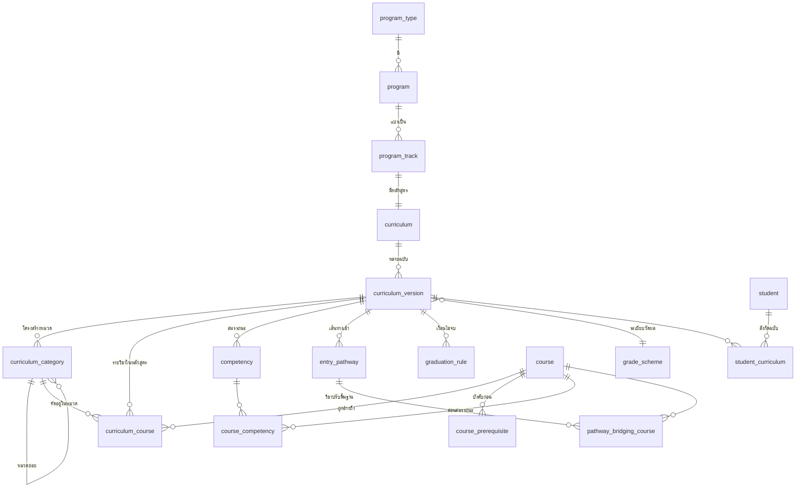
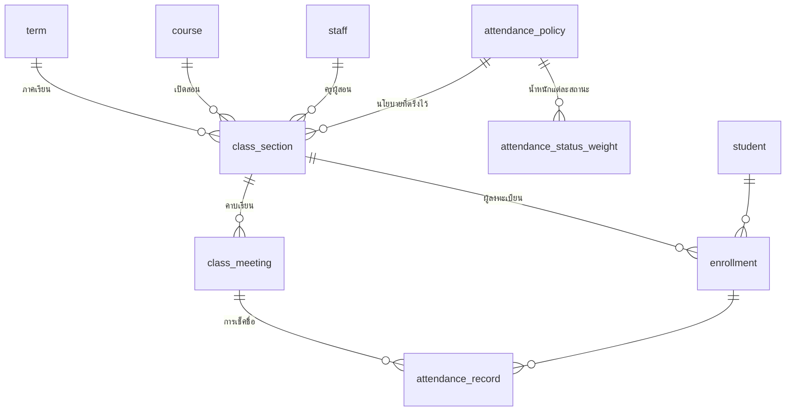
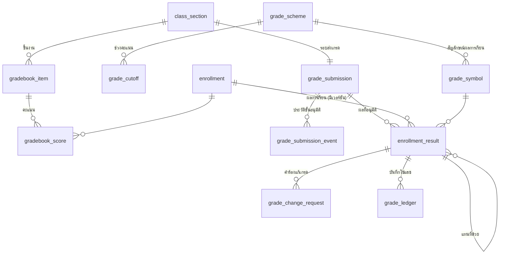
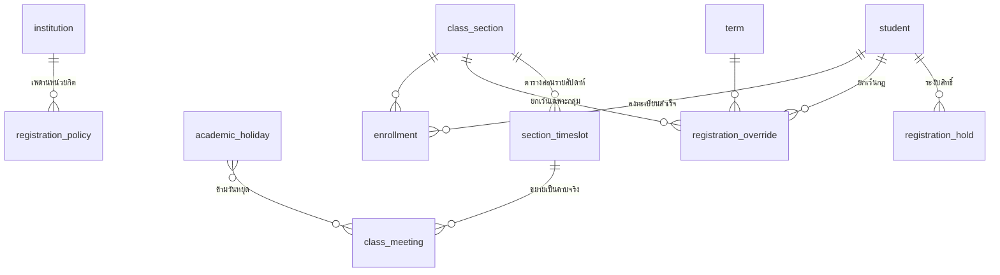
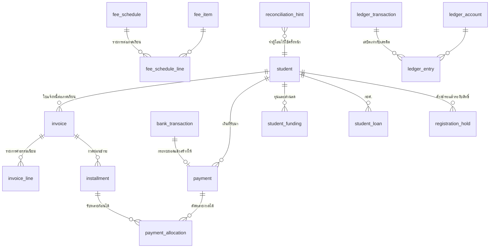
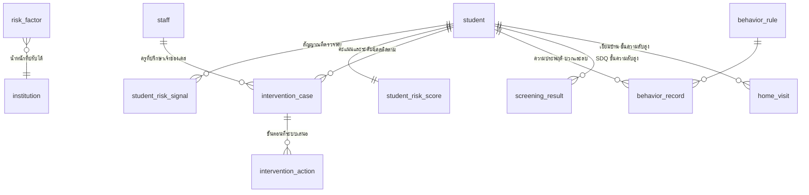
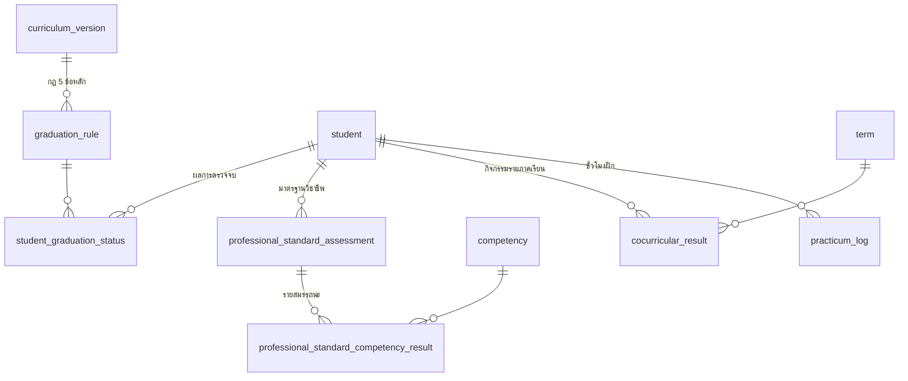

# แกนหลักสูตรและการวัดผล — ฐานข้อมูล

Schema ของแกนหลักสูตรฐานสมรรถนะแบบมีเวอร์ชัน พร้อมการวัดผลตามระเบียบ ปวช./ปวส.
สำหรับวิทยาลัยอาชีวศึกษาเอกชน

**สถานะ** — migrations ทั้ง 25 ไฟล์ seed และเทสต์ทั้ง 112 ข้อ (129 ข้อยืนยัน) รันผ่านบน PostgreSQL 18.4 แล้ว

ทุกตารางในสคีมาเปิด Row-Level Security แบบ force ครบแล้ว ไม่เหลือช่องว่าง

| | |
|---|---|
| ตาราง | 79 |
| มุมมอง | 11 |
| ชนิดข้อมูล enum | 39 |
| นโยบาย RLS | 53 |
| ดัชนี | 186 |

---

## วิธีรัน

```bash
createdb vecsms
for f in db/migrations/*.sql db/seed/*.sql; do psql -v ON_ERROR_STOP=1 -d vecsms -f "$f"; done
psql -v ON_ERROR_STOP=1 -d vecsms -f db/tests/0001_smoke.sql
```

หรือใช้สคริปต์ที่เตรียมไว้

```bash
bash db/run.sh
```

ต้องใช้ **PostgreSQL 15 ขึ้นไป** (ใช้ `pgcrypto`, `btree_gist` และ `security_invoker` บน view)

---

## ลำดับไฟล์

| ไฟล์ | เนื้อหา |
|---|---|
| `0001_foundation.sql` | สถานศึกษา ปฏิทินการศึกษา ฟังก์ชันบริบทผู้ใช้ |
| `0002_person_student.sql` | บุคคล นักศึกษา บุคลากร ผู้ปกครอง ประวัติสถานะ |
| `0003_curriculum.sql` | **แกนหลักสูตรและการทำเวอร์ชัน** หมวดวิชา สมรรถนะ เส้นทางเข้าศึกษา |
| `0004_course.sql` | รายวิชา การผูกเข้าหลักสูตร วิชาบังคับก่อน |
| `0005_registration_attendance.sql` | กลุ่มเรียน ลงทะเบียน เช็คชื่อ **กฎเวลาเรียน 80%** |
| `0006_assessment.sql` | ระเบียบวัดผล สมุดคะแนน ผลการเรียน อนุมัติเกรด บัญชีตรวจสอบ |
| `0007_graduation.sql` | เงื่อนไขจบ 5 ข้อ มาตรฐานวิชาชีพ กิจกรรม ฝึกประสบการณ์ |
| `0008_rls.sql` | Row-Level Security สองชั้น |
| `0009_registration_rules.sql` | **ตรวจเงื่อนไขการลงทะเบียน** ตารางสอน วันหยุด การระงับสิทธิ์ การยกเว้น |
| `0010_finance.sql` | **การเงิน** ค่าธรรมเนียม ใบแจ้งหนี้ ผ่อนชำระ กระทบยอด บัญชีแยกประเภท |
| `0011_early_warning.sql` | **เตือนก่อนออกกลางคัน** ความประพฤติ คัดกรอง เยี่ยมบ้าน เคสติดตาม |
| `0012_view_security_and_subject_scope.sql` | แก้ view ข้าม RLS · ให้นักศึกษาและผู้ปกครองเห็นข้อมูลของตน |
| `0013_fix_student_balance_fanout.sql` | แก้ยอดค้างถูกคูณด้วยจำนวนงวดผ่อนชำระ |
| `0014_authentication.sql` | รหัสผ่าน · session · การผูกอุปกรณ์ · บันทึกการเข้าระบบ |
| `0015_assessment_rls.sql` | **ปิดช่องโหว่** ตารางฝั่งวัดผลหกตัวไม่มี RLS เลย |
| `0016_grade_computation.sql` | **ตัดเกรดจากสมุดคะแนน** ขั้นตอนอนุมัติ · GPA และ GPAX |
| `0017_close_rls_gaps.sql` | **ปิดช่องโหว่ที่เหลือ** ตารางลูกอีก 28 ตารางไม่มี RLS |
| `0018_grade_change_request.sql` | **คำร้องแก้เกรดหลังล็อก** บังคับผู้อนุมัติสองคนที่ตัวตาราง |
| `0019_dual_vocational.sql` | **ทวิภาคี** สถานประกอบการ ข้อตกลง ใบส่งตัว รับรองชั่วโมงฝึก |
| `0020_clone_curriculum_version.sql` | **ออกฉบับหลักสูตรใหม่** คัดลอกทั้งก้อนพร้อม map uuid ใหม่ |
| `0021_login_rate_limit.sql` | **จำกัดจำนวนครั้งรายไอพี** กัน credential stuffing ที่การล็อกบัญชีกันไม่ได้ |
| `0022_staff_roles_and_audit.sql` | **สิทธิของบุคลากร** และบันทึกการเข้าถึงข้อมูล |
| `0023_data_import.sql` | **นำเข้าข้อมูลนักศึกษาและประวัติการเรียน** จากระบบเดิม |
| `0024_scale_indexes.sql` | **ดัชนีสำหรับข้อมูลขนาดจริง** trigram สำหรับค้นหา และดัชนีที่ขึ้นต้นด้วย institution_id |

---

## ERD

### หลักสูตรและการทำเวอร์ชัน



### ลงทะเบียน เช็คชื่อ และเวลาเรียน



### วัดผล อนุมัติเกรด และบัญชีตรวจสอบ



### การลงทะเบียน



### การเงิน



### เตือนก่อนออกกลางคัน



### เงื่อนไขจบ



---

## การตัดสินใจสำคัญ 8 ข้อ

### 1. หลักสูตรมีเวอร์ชัน และนักศึกษาถูกตรึงกับฉบับที่ตนเข้าศึกษา

`curriculum_version` มีช่วง `effective_from_year_be` ถึง `effective_to_year_be`
และมี exclusion constraint กันไม่ให้ปีเข้าศึกษาหนึ่งปีตกอยู่ใต้สองฉบับพร้อมกัน

```sql
exclude using gist (
  curriculum_id with =,
  int4range(effective_from_year_be, coalesce(effective_to_year_be, 9999), '[]') with &&
) where (status <> 'draft')
```

เหตุผล — ในปีการศึกษาหนึ่ง ปวช.1 อยู่ฉบับใหม่ ขณะที่ ปวช.3 ยังอยู่ฉบับเดิม
ถ้าใช้โครงสร้างเดียวทั้งวิทยาลัย เอกสาร รบ.1 ที่ออกย้อนหลังจะผิดทั้งหมด

### 2. หน่วยกิตอาชีวะเก็บสามคอลัมน์ ไม่ใช่คอลัมน์เดียว

`theory_hours` · `practice_hours` · `credits` แยกกัน เพราะทฤษฎี 1 ชม./สัปดาห์ = 1 นก.
แต่ปฏิบัติ 2–3 ชม./สัปดาห์ = 1 นก. และตัวเลขสามชุดถูกใช้คนละที่ —
ชั่วโมงใช้จัดตารางและคิดภาระงานครู หน่วยกิตใช้ตรวจจบ ชั่วโมงรวมใช้นับฝึกงานและเบิกวัสดุฝึก

### 3. หมวดวิชาเป็นต้นไม้ และหน่วยกิตไต่ขึ้นเอง

โครงสร้างอาชีวะซ้อนสองชั้น (หมวดวิชาสมรรถนะวิชาชีพ → กลุ่มวิชาชีพพื้นฐาน/เฉพาะ/เลือก/ฝึกประสบการณ์/โครงงาน)
`v_student_credits_by_category` ใช้ recursive CTE ไต่จากหมวดที่รายวิชาสังกัดขึ้นไปหาหมวดแม่
ทำให้เกณฑ์หน่วยกิตทั้งระดับกลุ่มและระดับหมวดตรวจได้จากข้อมูลชุดเดียว

### 4. กฎเวลาเรียน 80% เป็นมุมมอง ไม่ใช่ตรรกะในโค้ดแอป

`v_enrollment_attendance` เป็นแหล่งความจริงเดียวของเวลาเรียน คืนค่าสี่ตัว

| คอลัมน์ | ใช้ทำอะไร |
|---|---|
| `pct_to_date` | ตัวเลขที่แสดงให้นักศึกษาเห็นระหว่างภาค |
| `pct_final` | ตัวเลขทางการที่ใช้ตัดสิน ข.ร. ตอนปลายภาค |
| `pct_projected` | ถ้าเข้าครบทุกคาบที่เหลือจะจบภาคที่เท่าไร ใช้ตัดสินสถานะระหว่างภาค |
| `absences_left` | ขาดได้อีกกี่คาบ — ตัวเลขที่แสดงในแอปนักศึกษา |

`attendance_state` ใช้ `pct_projected` ไม่ใช่ `pct_final` เพราะกลางภาค `pct_final` จะต่ำเสมอ
โดยธรรมชาติ ถ้าใช้ตัดสินจะขึ้นว่า "หมดสิทธิ์สอบ" ให้ทุกคนตั้งแต่สัปดาห์แรก

น้ำหนักของแต่ละสถานะตั้งค่าได้ที่ `attendance_status_weight` เพราะแต่ละวิทยาลัยตีความ
เรื่อง "ลาป่วยที่มีใบรับรองแพทย์นับเป็นเวลาเรียนไหม" ไม่เหมือนกัน

นโยบายถูก **ตรึงไว้ที่กลุ่มเรียน** ตั้งแต่วันเปิดภาค การแก้นโยบายกลางภาคจึงไม่ย้อนไป
เปลี่ยนผลของกลุ่มที่เปิดไปแล้ว

### 5. สัญลักษณ์ผลการเรียนเป็นข้อมูล ไม่ใช่ enum ในโค้ด

`grade_symbol` เก็บทั้ง 4.0–0 และ ข.ร. ข.ส. ม.ส. ถ.น. ผ. ม.ผ. พร้อมคุณสมบัติว่า
นับใน GPA ไหม ได้หน่วยกิตไหม เป็นผลชั่วคราวที่ต้องแก้ภายในกี่วัน
ระเบียบ ปวช. กับ ปวส. ใช้คนละชุด และแก้ไขได้ในอนาคตโดยไม่ต้อง deploy

### 6. ผลการเรียนแก้ทับไม่ได้

`enrollment_result` มี `revision` และ `superseded_by` — แถวปัจจุบันคือแถวที่
`superseded_by is null` การแก้เกรดคือการออกแถวใหม่ที่ชี้กลับไปแถวเดิม
trigger ปฏิเสธทั้ง UPDATE (ยกเว้นการตั้ง `superseded_by`) และ DELETE

`attendance_pct` ถูกตรึงไว้ในแถวผลการเรียนด้วย ห้ามคำนวณใหม่ตอนพิมพ์เอกสาร
มิฉะนั้นเอกสารที่ออกย้อนหลังจะไม่ตรงกับที่เคยออกไป

การแก้เกรดหลังล็อกต้องผ่าน `grade_change_request` ที่บังคับผู้อนุมัติสองคนคนละคน

### 7. บัญชีตรวจสอบเป็นโซ่แฮช

ทุกการเขียนผลการเรียนถูกบันทึกลง `grade_ledger` โดย trigger คำนวณ
`hash = sha256(prev_hash || entity || entity_id || action || payload || occurred_at)`

การแก้แถวเก่าย้อนหลังทำให้แฮชที่คำนวณใหม่ไม่ตรงกับที่เก็บไว้ เรียก
`verify_grade_ledger(institution_id)` เพื่อตรวจ — smoke test ข้อ 6b พิสูจน์ว่าจับได้จริง

จำเป็นเพราะข้อมูลชุดนี้ใช้ยันจำนวนนักศึกษาที่ขอรับเงินอุดหนุน และใช้ออกเอกสารราชการ

### 8. RLS สองชั้น — permissive แล้วตามด้วย restrictive

PostgreSQL รวม policy แบบ **permissive ด้วย OR** และ **restrictive ด้วย AND**
ถ้าเขียนนโยบายขอบเขตบทบาทเป็น permissive มันจะไป OR กับนโยบายแยกสถานศึกษา
แล้วเปิดข้อมูลข้ามวิทยาลัยทันที

โครงสร้างที่ใช้จึงเป็น

- **ชั้นที่ 1 permissive** — เข้าถึงได้เมื่ออยู่ในสถานศึกษาเดียวกัน
- **ชั้นที่ 2 restrictive** — แล้วยังต้องผ่านขอบเขตของบทบาทอีกชั้น

ครูเห็นเฉพาะกลุ่มเรียนที่ตนสอน (รวมกรณีสอนแทน) นักศึกษาเห็นเฉพาะของตน
ผู้ปกครองเห็นได้เมื่อ `verified_at is not null` เท่านั้น

ตาราง `grade_ledger` มีเฉพาะนโยบาย SELECT และ INSERT โดยเจตนา — แม้แต่บทบาท admin
ก็ UPDATE หรือ DELETE ผ่านการเชื่อมต่อปกติไม่ได้

---

## เงื่อนไขจบเก็บเป็นข้อมูล

`graduation_rule` เก็บกฎเป็นแถว ไม่ใช่เขียนเป็นโค้ด ครอบคลุมเงื่อนไขทั้ง 5 ข้อตามระเบียบ

| kind | ความหมาย |
|---|---|
| `credits_total` | หน่วยกิตสะสมรวมขั้นต่ำ |
| `credits_by_category` | หน่วยกิตขั้นต่ำรายหมวด (`params.category_code`) |
| `required_courses` | ผ่านรายวิชาบังคับทุกรายวิชา |
| `gpax_min` | GPAX ไม่ต่ำกว่า 2.00 |
| `professional_standard` | ผ่านการประเมินมาตรฐานวิชาชีพ |
| `cocurricular_all_terms` | กิจกรรมเสริมหลักสูตรผ่านทุกภาคเรียน |
| `practicum_hours` | ชั่วโมงฝึกประสบการณ์ที่ครูฝึกรับรองแล้ว |
| `no_pending_grade` | ไม่มี ม.ส. หรือ ข.ส. ค้าง |

เรียก `evaluate_graduation(student_id)` ได้ทุกเมื่อ คืนแถวละหนึ่งกฎพร้อมเกณฑ์
ค่าที่ทำได้ และผ่านหรือไม่ ใช้ทั้งในหน้า "เส้นทางสู่การจบ" ของแอปนักศึกษา
และในงานทะเบียนตอนออก รบ.1

---

## ตรวจเงื่อนไขการลงทะเบียน

`check_registration(student_id, term_id, section_ids[])` คืน **รายการปัญหาทั้งหมด**
ไม่ใช่ true/false และไม่หยุดที่ข้อแรก เพราะนักศึกษาต้องเห็นทุกอย่างที่ต้องแก้ในรอบเดียว

| code | severity | ตรวจอะไร |
|---|---|---|
| `TERM_NOT_OPEN` | block | ภาคเรียนยังไม่เปิดรับลงทะเบียน |
| `STUDENT_NOT_ACTIVE` | block | นักศึกษาพักการเรียน ลาออก หรือพ้นสภาพ |
| `NO_CURRICULUM` | block | ยังไม่ได้กำหนดหลักสูตรให้นักศึกษา |
| `HOLD_FINANCE` และอื่น ๆ | block | มีการระงับสิทธิ์ค้างอยู่ |
| `SECTION_WRONG_TERM` | block | กลุ่มเรียนไม่ได้เปิดในภาคเรียนนี้ |
| `CREDIT_MAX` | block / warn | เกินเพดาน — เป็น warn ถ้ายังอยู่ในช่วงที่ขออนุมัติได้ |
| `CREDIT_MIN` | warn | ต่ำกว่าหน่วยกิตขั้นต่ำ |
| `PREREQ_NOT_MET` | block | ยังไม่ผ่านวิชาบังคับก่อน |
| `TIME_CONFLICT` | block | ตารางเรียนชนกัน |
| `SECTION_FULL` | block | ที่นั่งเต็ม |
| `ALREADY_PASSED` | warn | เคยผ่านรายวิชานี้แล้ว จะนับเป็นการเรียนซ้ำ |
| `NOT_IN_CURRICULUM` | warn | รายวิชาไม่อยู่ในโครงสร้างหลักสูตร จะไม่นับในการตรวจจบ |

### สามข้อที่ตั้งใจออกแบบให้เป็นแบบนี้

**ตัวตรวจไม่รู้จักงานการเงิน** — งานการเงินเขียน `registration_hold` เข้ามา
ตัวตรวจแค่ดูว่ามีการระงับค้างอยู่ไหม โมดูลการเงินจึงพัฒนาแยกได้โดยไม่ต้องแก้งานทะเบียน
และงานปกครองก็ใช้ช่องทางเดียวกันได้ทันที

**การยกเว้นต้องบันทึกเสมอ** — `registration_override` บังคับให้มีเหตุผลและผู้อนุมัติ
รายการที่ถูกยกเว้นยังคืนออกมาในผลตรวจโดยมี `waived = true` เพื่อให้เห็นว่าเคยติดอะไร
ระบบเก่ามักปล่อยให้ธุรการกดข้ามได้เงียบ ๆ ซึ่งตรวจสอบย้อนหลังไม่ได้
นโยบาย RLS แบบ restrictive จำกัดให้เฉพาะบทบาท registrar academic director admin
เท่านั้นที่เขียนตารางนี้ได้

**`TIME_CONFLICT` รายงานผูกกับกลุ่มเรียนที่กำลังจะเพิ่ม** ไม่ใช่กลุ่มที่ลงไปแล้ว
เพราะการยกเว้นต้องชี้ไปที่สิ่งที่ผู้ใช้กำลังทำ จุดนี้ถูกจับได้ตอนเขียนเทสต์ข้อ 22
เวอร์ชันแรกรายงานตาม UUID ที่น้อยกว่าซึ่งเป็นค่าที่คาดเดาไม่ได้

`register_courses()` เรียกตัวตรวจก่อนเสมอ ถ้ายังมีข้อ block ที่ไม่ได้ยกเว้น
จะ raise และ **ไม่เขียนอะไรลงฐานข้อมูลเลย** พร้อมตั้ง `attempt_no` ให้อัตโนมัติเมื่อเป็นการเรียนซ้ำ

### ตารางสอนและคาบเรียน

`section_timeslot` คือแบบแผนรายสัปดาห์ ส่วน `class_meeting` คือคาบที่เกิดขึ้นจริงในปฏิทิน
`generate_class_meetings()` ขยายแบบแผนไปตลอดภาคเรียน ข้ามวันหยุด แล้วซิงก์
`planned_periods` ซึ่งเป็นตัวหารของกฎเวลาเรียน 80% ฟังก์ชันจะปฏิเสธถ้ามีคาบที่สอนไปแล้ว
เพราะการเปลี่ยนตัวหารย้อนหลังจะเปลี่ยนผลของนักศึกษาทุกคนในกลุ่ม

มุมมอง `v_teacher_conflict` และ `v_room_conflict` ใช้ตอนจัดตารางสอน
ตรวจข้ามตารางจึงทำเป็นมุมมองแทน constraint

---

## การเงิน

**บัญชีเป็น double-entry ตั้งแต่วันแรก** `ledger_entry` มี constraint trigger แบบ deferred
ที่ตรวจตอน commit ว่าเดบิตเท่ากับเครดิต ใส่ไม่ครบคู่จะถูกปฏิเสธทั้งรายการ
เหตุผลที่ต้องทำตั้งแต่แรกคือการย้ายจากระบบที่ไม่ใช่ double-entry ทีหลังแทบเป็นไปไม่ได้

**เงินไม่ผูกกับใบแจ้งหนี้โดยตรง** แต่ผ่าน `payment_allocation` เพราะเงินก้อนเดียว
อาจตัดหลายงวด และงวดเดียวอาจมาจากหลายก้อน `post_payment()` ตัดตามลำดับวันครบกำหนด
และคืนค่าเงินที่เหลือ ถ้ามากกว่าศูนย์แปลว่าชำระเกิน

**กระทบยอดอัตโนมัติสี่ระดับ** `reconcile_bank_transactions()` ให้คะแนนความมั่นใจแล้ว
ตัดยอดเองเฉพาะที่มั่นใจตั้งแต่ 90 ขึ้นไป ที่เหลือขึ้นเป็นข้อเสนอให้เจ้าหน้าที่กดยืนยัน

| ระดับ | เงื่อนไข | ความมั่นใจ |
|---|---|---|
| 1 | Reference 2 ตรงกับใบแจ้งหนี้ | 100 |
| 2 | รหัสนักศึกษาและยอดตรงกับงวดที่ค้าง | 90 |
| 3 | ผู้โอนคนนี้เคยชำระให้นักศึกษาคนนี้มาก่อน | 80 |
| 4 | ยอดตรงกับงวดที่ค้างเพียงงวดเดียวในช่วงเวลาใกล้เคียง | 60 |

ระดับ 3 มาจาก `reconciliation_hint` ซึ่งจำชื่อผู้โอนที่เจ้าหน้าที่ยืนยันด้วยมือไว้
เพราะผู้ปกครองมักโอนจากบัญชีเดิมทุกงวด ยิ่งใช้ไปนานยิ่งจับคู่เองได้มากขึ้น

**การระงับสิทธิ์ไปที่ `registration_hold`** `refresh_finance_holds()` ตั้งเป็นงานประจำวัน
งานทะเบียนไม่ต้องรู้จักใบแจ้งหนี้เลย และเมื่อชำระครบระบบปลดให้เองพร้อมบันทึกเหตุผล

---

## เตือนก่อนออกกลางคัน

**คะแนนความเสี่ยงต้องอธิบายได้ ไม่ใช่กล่องดำ** ใช้กฎถ่วงน้ำหนักเก็บใน `risk_factor`
ที่ผู้ดูแลปรับเองได้ ปัจจัยเก้าตัวคือ ขาดเรียนติดต่อกัน · เวลาเรียนใกล้ตกเกณฑ์ ·
ค้างชำระ · ยังไม่ลงทะเบียน · ผลการเรียนต่ำ · ผลการเรียนค้างแก้ · มาสายบ่อย ·
คะแนนความประพฤติเหลือน้อย · ผลคัดกรองอยู่กลุ่มเสี่ยง

**สัญญาณเก็บเป็นข้อความไทยจริง** ไม่ใช่แค่รหัสหรือคะแนน เพราะครูต้องอ่านออกเสียง
ให้ผู้ปกครองฟังได้ว่าทำไมถึงโทรมา เช่น `ค้างชำระ 37,800 บาท เกินกำหนด 45 วัน`

**ขาดเรียนติดต่อกันนับเป็นวันเรียน ไม่ใช่วันปฏิทิน** รายวิชาที่สอนสัปดาห์ละครั้ง
วันที่ขาดจะห่างกันเจ็ดวันเสมอ ถ้านับตามปฏิทินจะไม่มีทางเจอการขาดติดต่อกันเลย

**ระบบสั่งงาน ไม่ใช่แค่แจ้งเตือน** `open_intervention_cases()` เปิดเคสให้ระดับส้มและแดง
มอบหมายครูที่ปรึกษา กำหนดวันครบกำหนดตอบสนอง และเสนอขั้นตอนที่ตรงกับสัญญาณที่พบจริง
ไม่ใช่ชุดสำเร็จรูปเดียวกันทุกคน เช่น ติดค้างชำระจึงเสนอส่งต่องานการเงิน

**แปลงเป็นตัวเงินได้** `v_revenue_at_risk` คิดจากค่าเทอมภาคปัจจุบันคูณจำนวนภาคเรียน
ที่เหลือจนจบ เพราะนักศึกษาที่หลุดหนึ่งคนคือรายได้ที่หายไปตลอดหลักสูตร ไม่ใช่แค่ภาคเดียว

**ข้อมูลชั้นความลับแยกสิทธิ์** ผลคัดกรอง SDQ และบันทึกเยี่ยมบ้าน ครูผู้สอนทั่วไปไม่เห็น
เห็นเฉพาะงานปกครอง แนะแนว และครูที่ปรึกษาที่เป็นเจ้าของเคสนั้น

---

## เทสต์ครอบคลุมอะไร

`tests/0001_smoke.sql` — แกนหลักสูตรและการวัดผล

| ข้อ | ทดสอบ |
|---|---|
| 1 | เลือกฉบับหลักสูตรจากปีเข้าศึกษาได้ถูกต้อง (2567 → ฉบับ 2567, 2565 → ฉบับ 2562) |
| 2 | กันฉบับหลักสูตรทับช่วงปีกัน |
| 3 | คำนวณเวลาเรียน 80.00% · ขาดได้อีก 10 คาบ · สถานะ warning |
| 4 | น้ำหนักสถานะการมาเรียนถูกนำมาคิด (ลากิจ = 0.5) |
| 5 | แก้ผลการเรียนทับไม่ได้ |
| 6 | โซ่แฮชสมบูรณ์ |
| 6b | แก้บัญชีย้อนหลังแล้วตรวจพบ |
| 7 | เปลี่ยนสถานะนักศึกษาแล้วบันทึกประวัติอัตโนมัติ |
| 8 | ตรวจจบคืนกฎครบ 10 ข้อ |
| 9 | หน่วยกิตไต่จากกลุ่มย่อยขึ้นหมวดแม่ |
| 10 | RLS กันการมองข้ามสถานศึกษา |
| 10b | สถานศึกษาตัวเองยังเห็นข้อมูลของตนได้ |

`tests/0002_registration.sql` — การลงทะเบียน

| ข้อ | ทดสอบ |
|---|---|
| 11 | ตรวจเวลาเรียนชนกัน (คาบ 3–4 กับ 4–5 วันจันทร์) |
| 12 | ผ่านวิชาบังคับก่อนแล้วไม่ติดเงื่อนไข |
| 12b | ยังไม่ผ่านวิชาบังคับก่อนแล้วติด block |
| 13 | การระงับจากงานการเงินบล็อกการลงทะเบียน |
| 14 | ติด block แล้วไม่เขียนอะไรลงฐานข้อมูลเลย |
| 15 | ยกเว้นกฎแล้วลงทะเบียนได้ และรายการยกเว้นยังปรากฏในผลตรวจ |
| 16 | ที่นั่งเต็มแล้วบล็อก |
| 17 | คืนทุกปัญหาในรอบเดียว ไม่หยุดที่ข้อแรก |
| 18 | เพดานหน่วยกิต — 24 นก. อยู่ในช่วงขออนุมัติได้จึงเป็น warn ไม่ใช่ block |
| 19 | สร้างคาบเรียนจากตารางสอน ข้ามวันหยุด และซิงก์ `planned_periods` |
| 20 | ห้ามสร้างคาบเรียนใหม่หลังเริ่มสอนแล้ว และ `planned_periods` ไม่ถูกแตะ |
| 21 | มุมมองตรวจครูสอนซ้อน |
| 22 | ยกเว้นเวลาชนแล้วลงทะเบียนได้ พร้อมตั้ง `attempt_no` ถูกต้อง |

`tests/0003_finance.sql` — การเงิน

| ข้อ | ทดสอบ |
|---|---|
| 23 | ออกใบแจ้งหนี้จากโครงสร้างค่าธรรมเนียม แบ่งงวด ผลรวมงวดตรงยอดพอดี |
| 24 | หักส่วนลดให้อัตโนมัติตอนออกใบแจ้งหนี้ |
| 25 | ตัดงวดตามลำดับครบกำหนด เงินส่วนเกินไหลลงงวดถัดไป |
| 26 | กระทบยอดอัตโนมัติ — Ref2 ตรงตัดยอดเอง ไม่มีอ้างอิงค้างไว้ให้คนตัดสิน |
| 27 | บัญชีแยกประเภทไม่สมดุลถูกปฏิเสธ |
| 27b | รายการที่เดบิตเท่ากับเครดิตบันทึกได้ |
| 28 | ค้างเกินกำหนดแล้วระงับสิทธิ์ และงานทะเบียนเห็นผลทันที |
| 29 | ชำระครบแล้วระบบปลดการระงับเอง |
| 30 | รายงานลูกหนี้แยกตามอายุหนี้ |

`tests/0004_early_warning.sql` — เตือนก่อนออกกลางคัน

| ข้อ | ทดสอบ |
|---|---|
| 31 | คะแนนความประพฤติหักตามกฎ |
| 32 | บันทึกเชิงบวกบวกคะแนนกลับ |
| 33 | คำนวณคะแนนความเสี่ยงจากสัญญาณหลายตัว |
| 34 | สัญญาณเป็นข้อความไทยที่ระบุตัวเลขจริง |
| 35 | เปิดเคสอัตโนมัติ พร้อมเสนอขั้นตอนที่ตรงกับสัญญาณที่พบ |
| 36 | รันซ้ำแล้วไม่เปิดเคสซ้อน |
| 37 | มุมมองหน้าจอครูที่ปรึกษา |
| 38 | มูลค่ารายได้ที่เสี่ยงจะสูญเป็นตัวเงิน |
| 39 | ปรับน้ำหนักปัจจัยแล้วคะแนนเปลี่ยนตาม — พิสูจน์ว่าไม่ใช่กล่องดำ |
| 40 | ครูผู้สอนทั่วไปไม่เห็นผลคัดกรองและบันทึกเยี่ยมบ้าน |
| 40b | งานปกครองเห็นข้อมูลชั้นความลับได้ตามหน้าที่ |

`tests/0005_view_isolation.sql` — การรั่วผ่าน view

| ข้อ | ทดสอบ |
|---|---|
| 41 | ทุก view ตั้ง `security_invoker` แล้ว |
| 42 | ไม่มี view ใดรั่วข้ามสถานศึกษา |
| 43 | วิทยาลัยตัวเองยังอ่านผ่าน view ได้ |
| 44 | นักศึกษาเห็นเฉพาะการลงทะเบียนของตัวเอง |

`tests/0006_assessment_rls.sql` — RLS ฝั่งวัดผล

| ข้อ | ทดสอบ |
|---|---|
| 45 | ตารางกลุ่มวัดผลทั้ง 11 ตารางเปิด RLS แบบ force |
| 45b | **ทุกตารางในสคีมา**เปิด RLS แบบ force — จับกรณีเพิ่มตารางใหม่แล้วลืมเขียนนโยบาย |
| 45c | ตารางที่เปิด RLS ต้องมีนโยบายอย่างน้อยหนึ่งข้อ (เปิดแล้วไม่มีนโยบาย = ปฏิเสธทุกอย่างเงียบ ๆ) |
| 46 | วิทยาลัยอื่นไม่เห็นข้อมูลวัดผลเลย |
| 46b | วิทยาลัยอื่นเขียนข้ามไม่ได้ |
| 47 | วิทยาลัยตัวเองยังเห็นครบ |
| 48 | นักศึกษาเห็นเฉพาะชิ้นงานที่ครูเปิดเผยแล้ว |
| 48b | นักศึกษาไม่เห็นขั้นตอนอนุมัติเกรดภายใน |
| 48c | นักศึกษาเห็น GPA ของตัวเอง |
| 49 | ครูที่ไม่ได้สอนกลุ่มนั้นไม่เห็นสมุดคะแนน |
| 50 | ครูผู้สอนเห็นและบันทึกคะแนนของกลุ่มตนได้ |
| 51 | ครูแก้ระเบียบวัดผลไม่ได้ ต้องเป็นฝ่ายวัดผล |

`tests/0007_grade_computation.sql` — ตัดเกรดและอนุมัติเกรด

| ข้อ | ทดสอบ |
|---|---|
| 52 | ดูตัวอย่างเกรดโดยไม่เขียนอะไรลงฐานข้อมูล |
| 53 | คะแนนถ่วงน้ำหนักและช่วงคะแนนตัดเกรดคิดถูก |
| 54 | เวลาเรียนไม่ถึงเกณฑ์ได้ ข.ร. แม้คะแนนเต็ม |
| 55 | กรอกคะแนนไม่ครบได้ ม.ส. ไม่ใช่คิดจากที่มี |
| 56 | ยังสอนไม่จบแล้วส่งเกรดไม่ได้ |
| 57 | ส่งเกรดแล้วเขียนผลและเลื่อนขั้น |
| 58 | ส่งซ้ำไม่ได้เมื่อส่งไปแล้ว |
| 59 | ข้ามขั้นอนุมัติไม่ได้ |
| 60 | เดินครบสายถึง locked แล้วแก้ไม่ได้ |
| 61 | ส่งใหม่หลังถูกตีกลับออก revision ใหม่ ไม่ใช่แก้ทับ |
| 62 | GPAX คิดจากหน่วยกิตรวม ไม่ใช่เฉลี่ยของ GPA |
| 63 | ทุกการเขียนผลถูกบันทึกลงบัญชีตรวจสอบและโซ่แฮชสมบูรณ์ |

`tests/0008_tenant_isolation.sql` — การแยกข้อมูลของตารางลูก

| ข้อ | ทดสอบ |
|---|---|
| 64 | วิทยาลัยอื่นไม่เห็นตารางลูก 18 ตารางเลยสักแถว |
| 65 | เขียนข้ามวิทยาลัยถูกปฏิเสธ (งวดผ่อนชำระ · คาบเรียน · ผู้ปกครอง) |
| 66 | วิทยาลัยตัวเองยังทำงานได้ครบเหมือนเดิม |
| 67 | ไม่เกิด infinite recursion ในนโยบายที่อ้างกันไปมา |
| 67b | นักศึกษาเห็นงวดของตัวเอง แต่ไม่เห็นการตัดยอดหลังบ้าน |
| 68 | ผู้ปกครองที่ยืนยันแล้วยังเข้าถึงข้อมูลบุตรได้ |
| 69 | ผู้ปกครองที่ยังไม่ยืนยันตัวตนไม่เห็นอะไรเลย |
| 70 | ครูเห็นคาบเรียนของกลุ่มที่ตนสอน |
| 70b | ครูแก้โครงสร้างหลักสูตรไม่ได้ |
| 71 | ฝ่ายวิชาการแก้ได้ตามหน้าที่ |

`tests/0009_grade_change_request.sql` — คำร้องแก้เกรดและ dual control

| ข้อ | ทดสอบ |
|---|---|
| 72 | ยังไม่ล็อกยื่นคำร้องไม่ได้ ให้ตีกลับแล้วส่งใหม่แทน |
| 73a | คำร้องที่ไม่รู้ว่าใครยื่นถูกปฏิเสธ |
| 73 | ต้องมีเหตุผลเสมอ และแก้เป็นค่าเดิมไม่ได้ |
| 74 | ใช้สัญลักษณ์ข้ามระเบียบวัดผลไม่ได้ |
| 75 | ยื่นคำร้องได้ และยื่นซ้ำขณะมีคำร้องค้างไม่ได้ |
| 76 | **ผู้ยื่นอนุมัติคำร้องของตัวเองไม่ได้** |
| 77 | คนแรกอนุมัติแล้วยังไม่มีผล และคนเดิมกดซ้ำไม่ได้ |
| 78 | เขียนตารางตรงเพื่อข้าม dual control ไม่ได้ทั้งสี่ทาง |
| 78b | ตั้งผู้อนุมัติสองคนพร้อมกันในคำสั่งเดียวไม่ได้ |
| 79 | ครบสองคนแล้วแก้ทันที ออก revision ใหม่ เวลาเรียนตรึงไว้ |
| 80 | คำร้องที่ปิดแล้วกดซ้ำไม่ได้ · บันทึกลงบัญชีตรวจสอบและโซ่แฮชสมบูรณ์ |

`tests/0010_dual_and_curriculum.sql` — ทวิภาคีและหลักสูตร

| ข้อ | ทดสอบ |
|---|---|
| 81 | สถานประกอบการที่สร้างใหม่ยังไม่ผ่านประเมิน รับนักศึกษาไม่ได้ |
| 82 | ส่งนักศึกษาคนเดียวไปฝึกสองที่พร้อมกันไม่ได้ (ชั่วโมงจะถูกนับซ้ำ) |
| 83 | ชั่วโมงฝึกต้องผูกกับสถานประกอบการที่มีอยู่จริง |
| 84 | ชั่วโมงที่ยังไม่รับรองไม่ถูกนับในการตรวจจบ แต่แสดงเป็นยอดรอรับรอง |
| 85 | นักศึกษารับรองชั่วโมงของตัวเองไม่ได้ |
| 86 | ครูนิเทศรับรองแล้วชั่วโมงจึงเข้าเกณฑ์ตรวจจบ |
| 87 | นักศึกษาเห็นเฉพาะใบส่งตัวของตัวเอง |
| 88 | วิทยาลัยอื่นไม่เห็นข้อมูลทวิภาคีเลย |
| 89 | โคลนฉบับหลักสูตรครบทุกส่วน และหมวดวิชาไม่ชี้ข้ามฉบับ |
| 90 | ออกฉบับซ้ำปีเดิมไม่ได้ |

`tests/0011_staff_roles_and_audit.sql` — สิทธิบุคลากรและบันทึกการเข้าถึง

| ข้อ | ทดสอบ |
|---|---|
| 91 | บุคลากรที่ยังไม่ได้รับมอบหมายบทบาทเข้าระบบไม่ได้ |
| 92 | ครูผู้สอนได้ teacher · นักศึกษาได้ student |
| 93 | มอบหมายบทบาทแล้วล็อกอินได้เป็นบทบาทนั้น |
| 94 | ถือหลายบทบาทได้ตัวที่แรงที่สุด |
| 95 | บทบาทเดิมซ้อนช่วงเวลากันไม่ได้ |
| 96 | ตัดสิทธิ์ทันทีได้ และประวัติยังอยู่ |
| 97 | **ยกระดับตัวเองเป็น admin ไม่ได้** |
| 97b | บทบาทอื่นอ่านทะเบียนสิทธิได้ แต่แก้ไม่ได้ |
| 98 | วิทยาลัยอื่นไม่เห็นทะเบียนสิทธิและบันทึกการเข้าถึง |
| 99 | เจ้าของข้อมูลเห็นเฉพาะบันทึกที่เกี่ยวกับตน (PDPA ม.30) |
| 100 | admin แก้และลบบันทึกการเข้าถึงไม่ได้ |
| 101 | ตั้งระยะเก็บต่ำกว่า 90 วันไม่ได้ · ล้างของเก่าได้ |

`tests/0012_data_import.sql` — นำเข้าข้อมูล

| ข้อ | ทดสอบ |
|---|---|
| 102 | ตรวจหลักที่ 13 ของเลขประจำตัวประชาชน |
| 103 | คืนปัญหาทั้งหมดของแถวในรอบเดียว ไม่ใช่ข้อแรก |
| 104 | รหัสประจำตัวที่มีอยู่แล้วถูกจับได้ |
| 105 | **มีแถวผิดแม้แถวเดียว ไม่เขียนอะไรเลย** |
| 106 | แก้แถวที่ผิดแล้วนำเข้าได้ครบ |
| 107 | นำเข้าซ้ำรอบเดิมไม่ได้ |
| 108 | เก็บเลขประจำตัวประชาชนเป็นค่าแฮช ไม่เก็บแบบอ่านออก |
| 109 | ประวัติที่นำเข้าไม่ปนกับผลที่ระบบตัดเอง |
| 110 | หน่วยกิตที่ยังไม่อนุมัติเทียบโอนไม่ถูกนับ |
| 111 | บทบาทที่ไม่มีอำนาจนำเข้าข้อมูลไม่ได้ |
| 112 | วิทยาลัยอื่นไม่เห็นข้อมูลการนำเข้า |

---

## สิ่งที่ยังไม่ได้ทำ

อยู่นอกขอบเขตแกนหลักสูตร ต้องต่อในเฟสถัดไป

- จัดตารางสอนอัตโนมัติ — `section_timeslot` กับมุมมองตรวจการชนเป็นข้อมูลนำเข้าของ solver
- งานรับสมัครและ CRM · ครูและบุคลากร · วัสดุฝึกและครุภัณฑ์ · ศิษย์เก่าและภาวะการมีงานทำ
- ด้านจ่ายของงานการเงิน — จัดซื้อจัดจ้าง งบประมาณ เจ้าหนี้ และ e-Tax Invoice
- การส่งออกเข้า ศธ.02 ควรอยู่หลัง Integration Bus ไม่ใช่ในแกน
- เข้ารหัสระดับฟิลด์จริง (คอลัมน์ `*_enc` เตรียมไว้แล้ว รอเชื่อม KMS)
- ชั้นแอปพลิเคชันทั้งหมด — API เว็บ และแอปมือถือ
