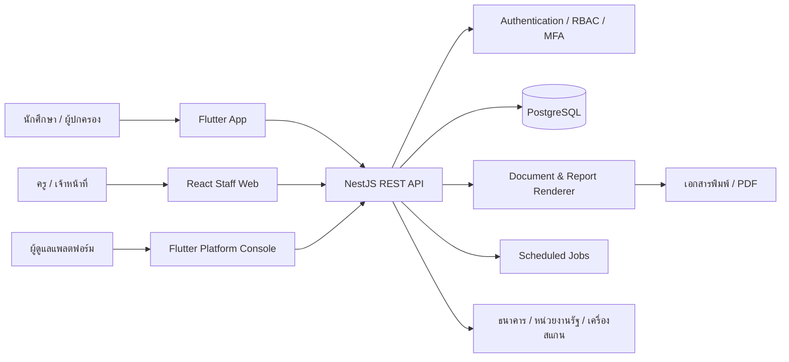
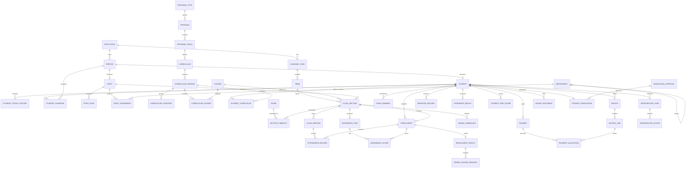
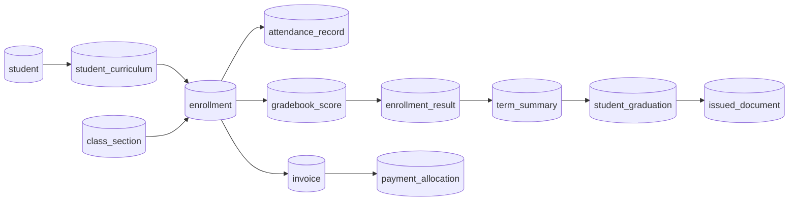
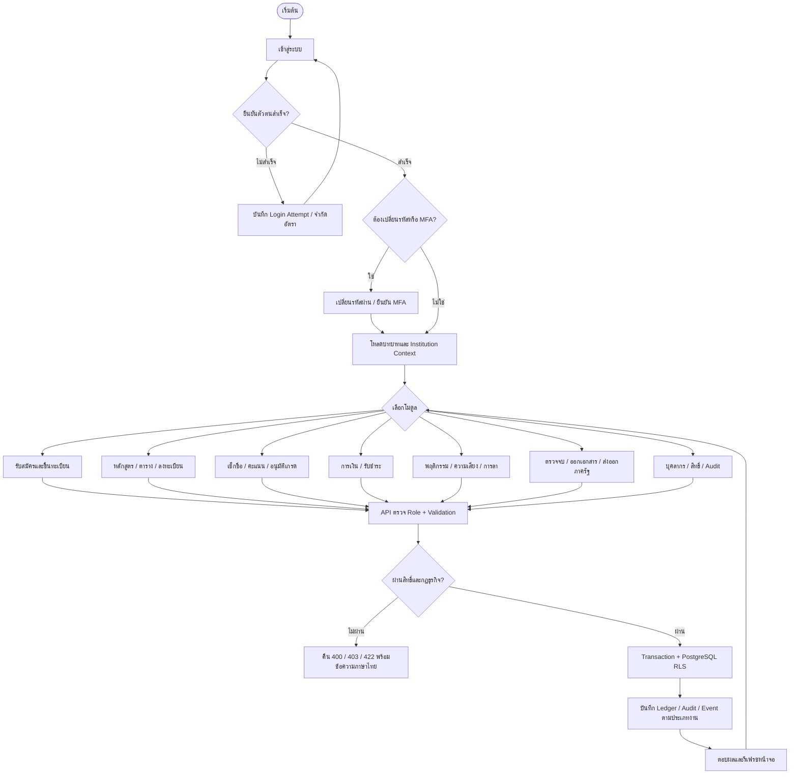
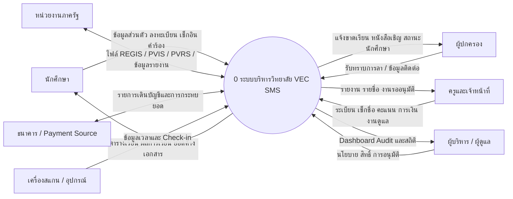
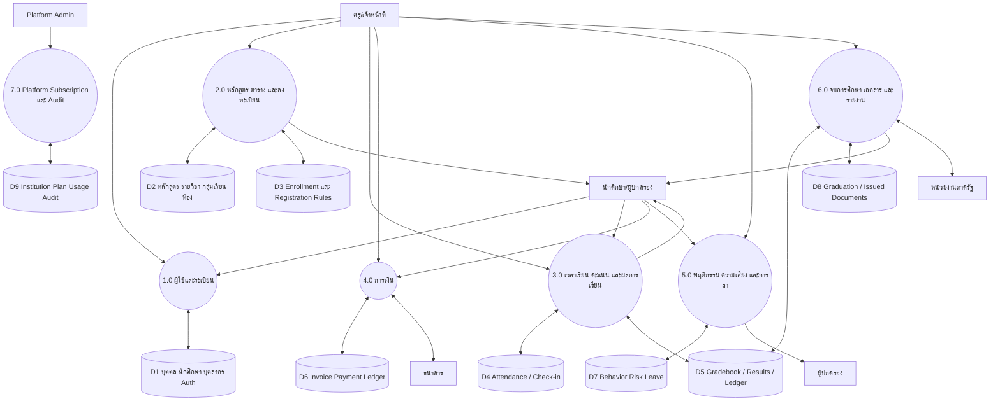
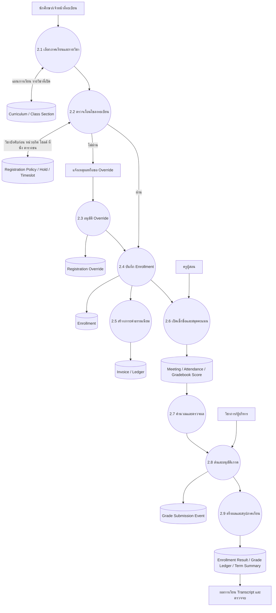

# VEC SMS — Database Schema, Flowchart, DFD และ Sitemap

เอกสารนี้อ้างอิงจาก migrations, NestJS controllers และ React routes ณ วันที่ 14 สิงหาคม 2569

## 1. ภาพรวมสถาปัตยกรรม

## 2. Database Schema

ฐานข้อมูลเป็น PostgreSQL แบบ Multi-tenant ตารางธุรกิจส่วนใหญ่ผูก `institution_id` และบังคับสิทธิ์ด้วย Row-Level Security (RLS)

### 2.1 Core ER Diagram

### 2.2 กลุ่มตารางทั้งหมด

| Domain | ตารางหลัก |
|---|---|
| Tenant/Academic calendar | `institution`, `academic_year`, `term`, `academic_holiday` |
| Person/Student | `person`, `student`, `student_status_history`, `student_guardian`, `student_parent`, `student_advisor`, `person_address`, `person_sensitive`, `student_prior_education` |
| Staff/HR | `staff`, `staff_role`, `department`, `staff_assignment`, `staff_record`, `staff_child`, `staff_leave`, `staff_attendance` |
| Curriculum | `program_type`, `program`, `program_track`, `curriculum`, `curriculum_version`, `curriculum_category`, `course`, `curriculum_course`, `course_prerequisite`, `competency` |
| Registration/Timetable | `class_section`, `enrollment`, `room`, `section_timeslot`, `teacher_availability`, `registration_policy`, `registration_hold`, `registration_override`, `student_class_placement` |
| Attendance | `attendance_policy`, `attendance_status_weight`, `class_meeting`, `attendance_record`, `attendance_checkin`, `student_leave`, `student_leave_applied` |
| Gradebook | `grade_scheme`, `grade_symbol`, `grade_cutoff`, `gradebook_item`, `gradebook_score`, `grade_submission`, `grade_submission_event`, `enrollment_result`, `grade_change_request`, `grade_ledger`, `term_summary` |
| Graduation/Practicum | `professional_standard_assessment`, `cocurricular_result`, `practicum_log`, `graduation_rule`, `student_graduation_status`, `student_graduation`, `graduation_approval` |
| Finance | `ledger_account`, `ledger_transaction`, `ledger_entry`, `fee_item`, `fee_schedule`, `invoice`, `invoice_line`, `installment`, `payment`, `payment_allocation`, `bank_transaction`, `late_fee_policy` |
| Behavior/Risk | `behavior_rule`, `behavior_record`, `behavior_policy`, `screening_result`, `home_visit`, `risk_factor`, `student_risk_signal`, `student_risk_score`, `intervention_case`, `intervention_action` |
| Admissions | `admission_round`, `admission_quota`, `application`, `application_choice`, `application_document` |
| Documents | `document_series`, `issued_document`, `institution_document_text` |
| Import/Export | `import_batch`, `import_row`, `prior_academic_record` และ Government Export views/services |
| Authentication/Audit | `user_credential`, `auth_identity`, `auth_session`, `login_attempt`, `mfa_credential`, `password_reset`, `access_log`, `request_rate` |
| Platform/SaaS | `plan`, `institution_subscription`, `usage_snapshot`, `platform_user`, `platform_session`, `platform_action_log`, `provisioning_log` |

### 2.3 Registration–Grade–Finance Data Chain

## 3. System Flowchart

## 4. DFD Level 0 — Context Diagram

## 5. DFD Level 1 — กระบวนการหลัก

## 6. DFD Level 2 — งานลงทะเบียนถึงประกาศผล

## 7. Sitemap — Staff Web

```mermaid
flowchart TD
    ROOT[Staff Web] --> LOGIN[เข้าสู่ระบบ / MFA / เปลี่ยนรหัสผ่าน]
    ROOT --> HUB[เมนูศูนย์งาน]
    HUB --> REG[ศูนย์งานทะเบียน]
    HUB --> HRH[ศูนย์งานบุคลากร]
    HUB --> TTH[ศูนย์งานตารางเรียน]
    HUB --> STH[ศูนย์การตั้งค่า]
    HUB --> BEH[ศูนย์งานพฤติกรรม]

    ROOT --> REGG[งานทะเบียน]
    REGG --> STUDENTS[ระเบียนนักศึกษา /students]
    STUDENTS --> PROFILE[ข้อมูลทั่วไป ที่อยู่ ผู้ปกครอง สุขภาพ การศึกษาเดิม ที่ปรึกษา สถานะ]
    REGG --> ENROLL[ลงทะเบียนเรียน /registration]
    REGG --> DOCS[ออกเอกสาร /documents]
    REGG --> GRAD[สำเร็จการศึกษา /graduation]
    REGG --> ADMIT[งานรับสมัคร /admissions]
    REGG --> IMPORT[นำเข้าข้อมูล /import]
    REGG --> GOV[ส่งออกข้อมูลรัฐ /government-exports]

    ROOT --> FIN[การเงิน /finance]
    ROOT --> ACADEMIC[งานวัดผล]
    ACADEMIC --> CURR[โครงสร้างหลักสูตร /curriculum]
    ACADEMIC --> TT[ตารางสอน /timetable]
    ACADEMIC --> AY[งานวิชาการรายปี /academic-year]
    ACADEMIC --> DUAL[ทวิภาคี /dual]
    ACADEMIC --> GB[สมุดคะแนน /gradebook]
    ACADEMIC --> ATT[เช็กชื่อรายคาบ /attendance]
    ACADEMIC --> CHANGE[คำร้องแก้เกรด /change-requests]

    ROOT --> CARE[ดูแลนักศึกษา]
    CARE --> RISK[เฝ้าระวัง /risk]
    CARE --> BREC[พฤติกรรม /behavior]
    CARE --> LETTER[หนังสือผู้ปกครอง /letters]
    CARE --> LEAVE[การลานักศึกษา /leaves]

    ROOT --> HR[บุคลากรและการลา /hr]
    ROOT --> SYSTEM[ระบบ]
    SYSTEM --> JOBS[งานตามกำหนดเวลา /jobs]
```

## 8. ขอบเขตระบบตาม Actor

| Actor | งานหลัก |
|---|---|
| นักศึกษา | ตารางเรียน เช็กอิน เวลาเรียน ผลการเรียน การเงิน ความพร้อมจบ และโปรไฟล์ |
| ผู้ปกครอง | รับทราบการลา หนังสือแจ้งเตือน และข้อมูลนักศึกษาในความดูแล |
| ครู | กลุ่มเรียน เช็กชื่อ สมุดคะแนน ส่งเกรด ที่ปรึกษา และติดตามนักศึกษา |
| งานทะเบียน/วิชาการ | ระเบียน ลงทะเบียน หลักสูตร ตาราง อนุมัติเกรด เอกสาร และตรวจจบ |
| การเงิน | ใบแจ้งหนี้ รับชำระ จัดสรรยอด กระทบยอด และรายงานลูกหนี้ |
| กิจการนักศึกษา | พฤติกรรม การลา คัดกรอง ความเสี่ยง เยี่ยมบ้าน และหนังสือผู้ปกครอง |
| ผู้บริหาร | อนุมัติ ดูภาพรวม Audit และรายงาน |
| Platform Admin | Institution, Plan, Subscription, Usage และ Provisioning |

## 9. หมายเหตุสำหรับพัฒนาต่อ

- ER Diagram แสดงความสัมพันธ์แกนหลักเพื่อให้อ่านได้ ไม่ได้วาดทุกตารางเชื่อมกันในภาพเดียว
- ตารางเอกสารใช้ payload ที่ตรึง ณ เวลาออกเอกสาร การพิมพ์ซ้ำต้องอ่านจาก `issued_document`
- ผลการเรียนที่ประกาศแล้วมี `grade_ledger` และ event สำหรับ Audit ห้ามแก้ทับโดยตรง
- สิทธิ์จริงควบคุมที่ API Roles และ PostgreSQL RLS ไม่ใช่การซ่อนเมนูหน้าเว็บ
- โมดูล Mockup ที่ยังไม่มี schema เฉพาะ ได้แก่ O-NET, ชุมนุม/ชมรม, RFID และเครื่องมือรูปภาพบางส่วน
